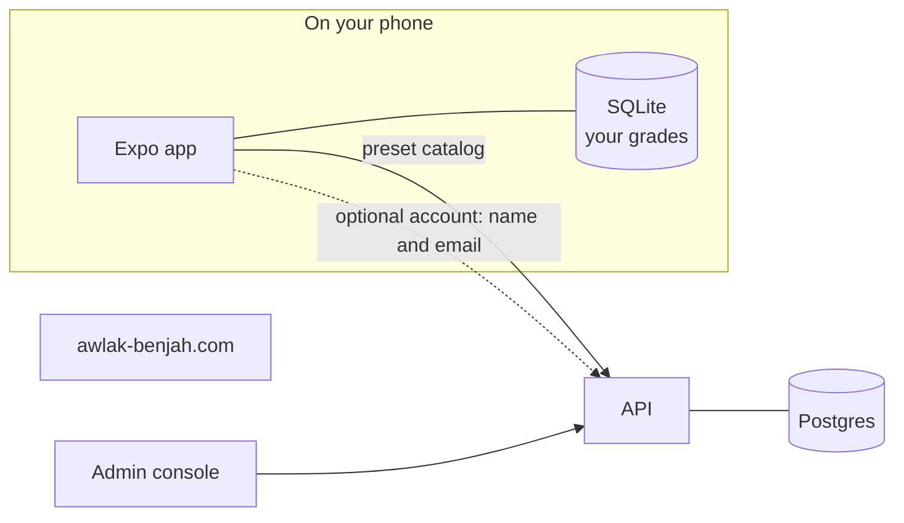

# Awlak Benjah?

**Track your degree semester by semester and see your projected average against the pass mark.** 
Offline. No account. In English, French and Arabic.

[awlak-benjah.com](https://awlak-benjah.com)

 

<table>
  <tr>
    <td align="center">
      <picture>
        <source media="(prefers-color-scheme: dark)" srcset="https://raw.githubusercontent.com/Awlak-Benjah/.github/main/profile/screens/en-US-dark.jpg" />
        
      </picture>
       English
    </td>
    <td align="center">
      <picture>
        <source media="(prefers-color-scheme: dark)" srcset="https://raw.githubusercontent.com/Awlak-Benjah/.github/main/profile/screens/fr-FR-dark.jpg" />
        
      </picture>
       Français
    </td>
    <td align="center">
      <picture>
        <source media="(prefers-color-scheme: dark)" srcset="https://raw.githubusercontent.com/Awlak-Benjah/.github/main/profile/screens/ar-SA-dark.jpg" />
        
      </picture>
       العربية
    </td>
  </tr>
</table>

## What we hold ourselves to

- **Your grades stay on your phone.** The app works with no account. Signed out, it downloads degree presets and sends anonymous crash reports, which you can turn off, and that's all. Every change that would send data anywhere updates the privacy policy in the same pull request, or it doesn't ship.
- **Arabic is laid out right to left from the start, not translated at the end.** Every screen mirrors, down to the native menus and sheets. React Native doesn't reach those on its own, so we wrote a native module that does.
- **Native where your thumb lands.** On iOS, toggles, menus, pickers and sheets are SwiftUI with Liquid Glass. On Android they're our own. Everything around them is our own design.
- **Lint checks the architecture, so reviews don't have to.** Module boundaries, MVVM layers and "no logic in a view" are rules that fail the build.

## How it's built

| | |
| --- | --- |
| **App** | Expo SDK 58, React Native 0.88, SwiftUI through `@expo/ui`, SQLite with Drizzle, Reanimated |
| **API** | NestJS, contract-first oRPC, Postgres, better-auth |
| **Console** | Vite, React, TanStack Router and Query, shadcn |
| **Site** | Astro on Cloudflare Workers |
| **Repo** | Turborepo, pnpm, TypeScript 7, oxlint, dependency-cruiser, release-please |

The app's source is private. Questions: [support@awlak-benjah.com](mailto:support@awlak-benjah.com)
